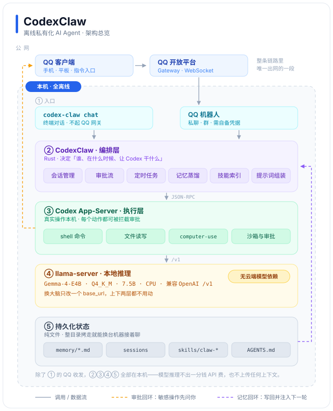

# CodexClaw

> **把一台普通 Windows 机器，变成可以远程指挥的私有 AI 工作站。**

在手机上发一条 QQ 消息，电脑就真的去干活：读文件、改代码、跑命令、操作桌面。
模型跑在本机，上下文不出机器。



## 它不是又一个聊天框

大多数「AI 助手」止步于**说话**。CodexClaw 解决的是**落地**——
它把强模型接上一副真正能操作电脑的手脚，并且给每个动作加上边界与留痕。

它只做三件事：

| | |
|---|---|
| **承载** | 把 Codex 的执行能力（shell / 文件 / computer-use / 沙箱）编排成一个可远程指挥的常驻服务 |
| **离线化** | 把大脑换成任意 OpenAI 兼容端点，模型、执行、编排全部在本机闭环 |
| **可加装** | 能力以「技能包」形式离线装入，不重新编译、不联网、即插即用 |

## 五层结构

| 层 | 角色 | 要点 |
|----|------|------|
| ① 入口 | QQ 机器人 · 终端 chat | 手机与终端两条通道，共用同一套内核 |
| ② 编排 | **CodexClaw**（Rust） | 会话、审批、调度、记忆、技能、提示词——决定「谁在什么时候让 Codex 干什么」 |
| ③ 执行 | **Codex App-Server** | 真实操作本机；每个敏感动作都可被拦截等待确认 |
| ④ 推理 | **llama-server** | OpenAI 兼容端点；换大脑只改一个 `base_url`，上下两层都不动 |
| ⑤ 状态 | 纯文件 | 记忆、会话、技能都是可读的 Markdown / 目录，整包拷走就能换机接着聊 |

两条回环让它不像「一次性问答」：

- **审批回环** —— 执行层要动手前，先把动作送回你的 QQ，你点头它才做。
- **记忆回环** —— 每轮结束自动蒸馏经验，写回状态，下一轮再注入。

> 除 ① 的 QQ 收发出网，②③④⑤ 全在本机。模型推理不产生云端 API 费用，也不上传上下文。

## 两种用法

| 入口 | 适合 | 说明 |
|------|------|------|
| **QQ 机器人** | 人在外面，想指挥家里的机器 | 走 QQ 官方开放平台，需自备 AppID / AppSecret |
| **`codex-claw chat`** | 人就在机器前 | 终端对话框，不起 QQ 网关；记忆、技能、会话与机器人共用 |

## 目录结构

```
codexclaw_portable/
├─ start-portable.bat    一键启动：自检 → 起大脑 → 等就绪 → 起 CodexClaw
├─ chat.bat              本地对话窗口（不启 QQ）
├─ _portable-env.bat     共用环境：HOME / PATH / 状态目录
├─ codex-claw.exe        编排层主程序
├─ codex-cli/            执行层（OpenAI Codex CLI）
├─ llamacpp/             大脑：llama-server + Gemma-4-E4B gguf（约 4.6GB）
├─ config/               主配置 + codex provider 配置
├─ skills/               技能包示例：sys-health / downloads-report / computer-use
├─ install-skill.bat     离线加装技能
├─ uninstall-skill.bat   离线卸载技能
├─ codexclaw-src/        上游文档子集
├─ DEPLOY.md             离线部署指南（路径改写 / 离线排错 / 便携模式）
├─ LICENSE               MIT
└─ THIRD-PARTY-NOTICES.md 第三方组件与模型权重许可
```

状态目录默认在 `~/.codex-claw/`；`CC_PORTABLE_DATA=1` 时改为包内 `data/`，
让 U 盘里的这份副本连记忆一起搬家。

## 三条设计取向

- **边界清晰** —— 编排层不碰执行细节，执行层不碰业务编排，推理层只认 OpenAI 协议。
  想换模型？改一个字段。想换入口？加一个适配器。
- **默认收权** —— 危险动作要你确认，沙箱先兜底，日志全留痕。
- **状态即文件** —— 不锁进数据库，不埋进黑盒上下文。记忆是 `.md`，技能是文件夹，随时可读可改可迁。

## 环境要求

- Windows x64（脚本 `.bat`，二进制 win32-x64）
- 磁盘约 **5.0GB**，其中模型 gguf 约 4.6GB
- 已在 `codex-cli 0.137.0` + `Gemma-4-E4B-It Q4_K_M` 上验证本地全链路

## 当前状态

**说明先行，文件暂未上传。** 本仓库目前只放文档与架构图，源码与离线包待整理后发布。

已实测：本地自检 6/6、离线对话、记忆读写、技能安装/卸载/发现、便携模式状态隔离。
QQ 入口需配置真实凭据后自测。

## 许可

本项目 MIT。随包分发的第三方组件（OpenAI Codex CLI、llama.cpp、Gemma 模型权重）
遵循各自上游许可 —— **模型权重不是 MIT**，商用或再分发前请阅读其条款。
